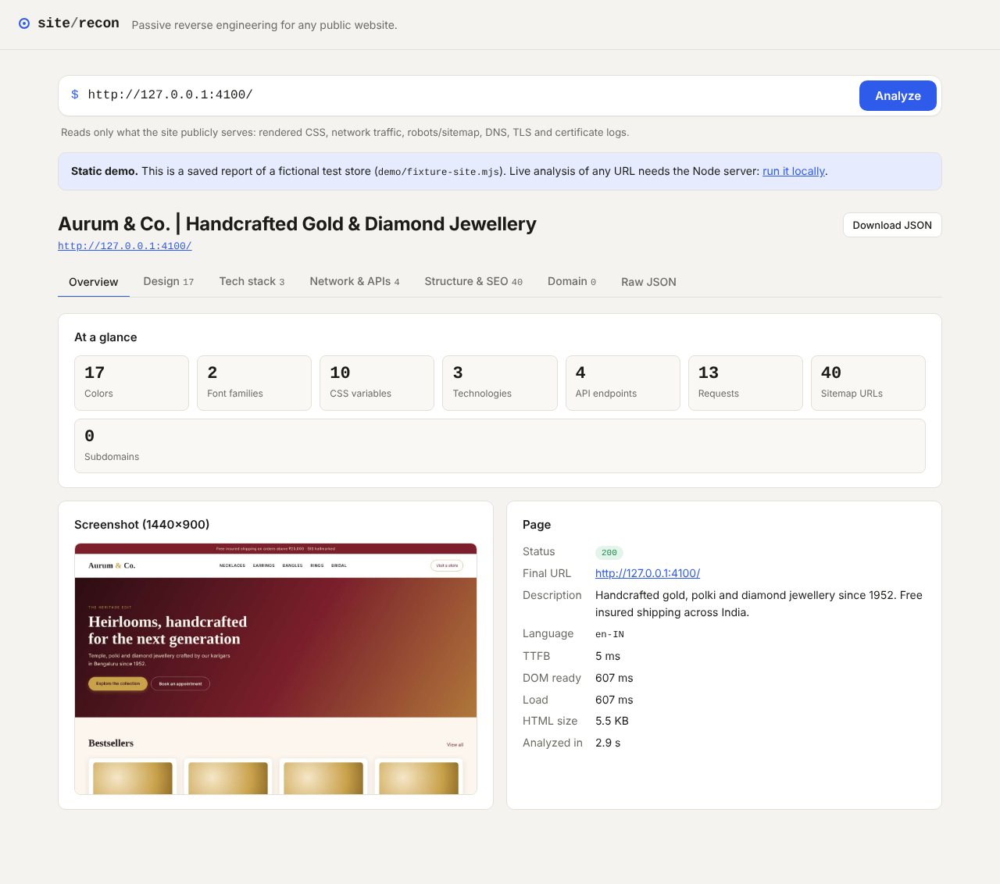
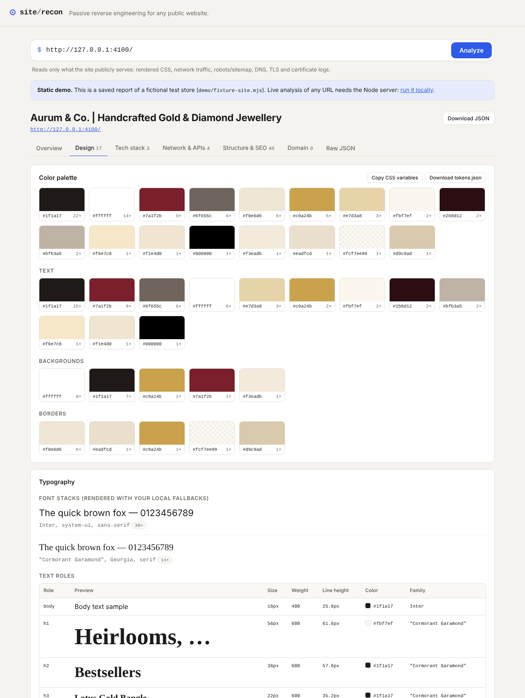
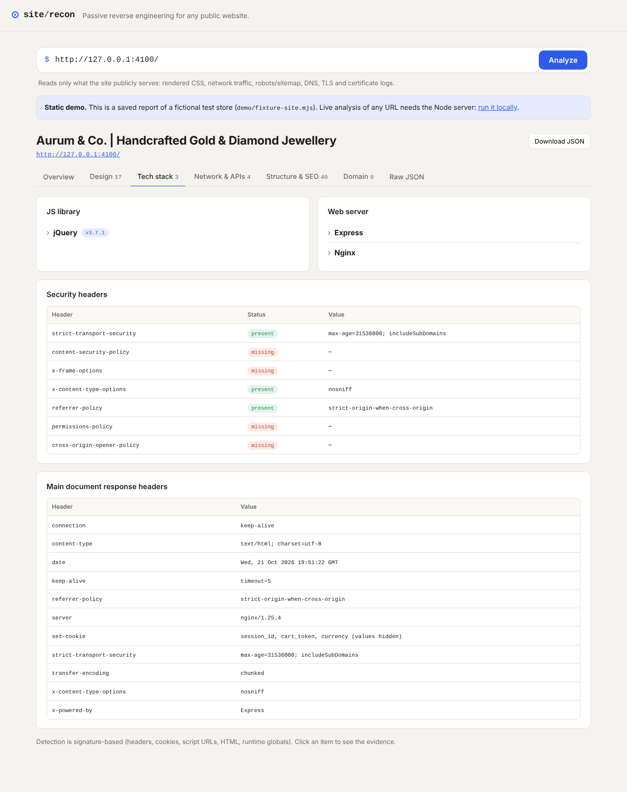
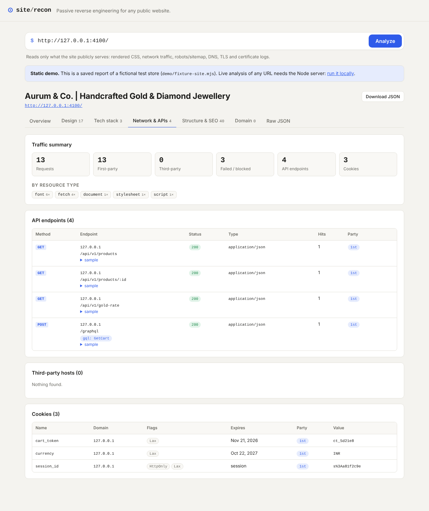
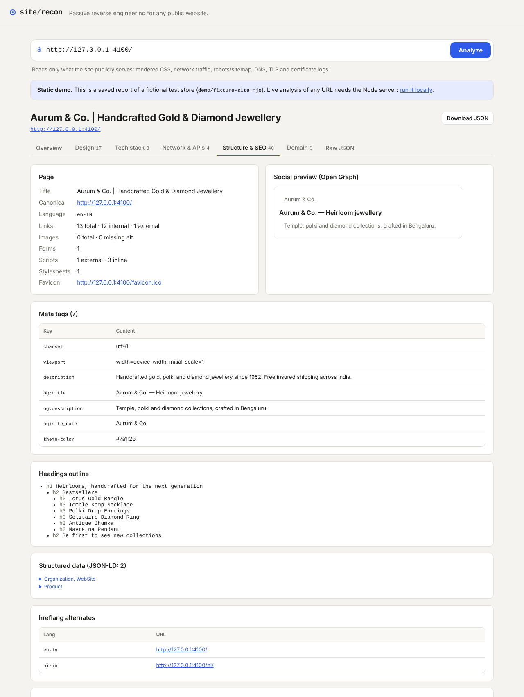
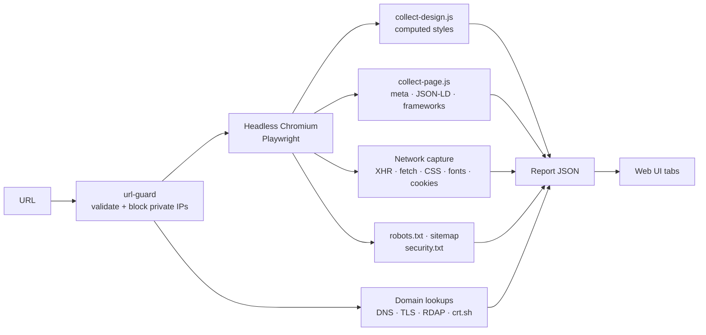

# Decode Websites — Site Recon

Passive website reverse-engineering. Paste a URL and get the site's **design system, tech stack, APIs, structure and domain intel** in one report.

**Live demo:** https://vedesh-reddy.github.io/decode-websites/

> The hosted demo is static (GitHub Pages has no server), so it shows a saved report of a fictional test store that ships with this repo. To analyze any URL live, run it locally (below).



## What it extracts

| Tab | What you get |
|---|---|
| **Design** | Color palette (text / background / border), CSS variables, font stacks, text roles (h1–h6, p, a, button…), type scale, weights, line heights, `@font-face` rules and font files, radii, shadows, gradients, spacing. Exports `tokens.json` and a ready `:root {}` CSS block. |
| **Tech stack** | Ecommerce platform (SFCC, PWA Kit, Shopify, Magento…), CMS, JS/CSS frameworks, analytics, tag managers, payments, search, CDN/hosting, web server, each with the evidence that matched. Security-header audit. |
| **Network & APIs** | Every XHR/fetch call grouped into endpoints (`/products/123` → `/products/:id`), GraphQL operation names, sample request/response bodies, third-party hosts, cookies, WebSockets. |
| **Structure & SEO** | Meta tags, Open Graph preview, JSON-LD, headings outline, hreflang, link/image stats, robots.txt, sitemap with sections, security.txt. |
| **Domain** | DNS (A, AAAA, CNAME, MX, TXT, NS, DMARC), detected services (email provider, verifications, DNS host, CDN), TLS certificate, registration via RDAP, subdomains from certificate-transparency logs. |

## Screenshots

| Input: the target site | Design tokens |
|---|---|
|  |  |

| Tech stack | Network & APIs |
|---|---|
|  |  |

| Structure & SEO |
|---|
|  |

## Quick start

Requires Node 20+.

```bash
git clone https://github.com/Vedesh-reddy/decode-websites.git
cd decode-websites
npm install
npm run setup      # one-time Chromium download for Playwright
npm run dev        # http://localhost:3000
```

Try it against the bundled test store:

```bash
npm run demo:site                     # terminal 1 → http://127.0.0.1:4100
ALLOW_PRIVATE=true npm run dev        # terminal 2, then analyze http://127.0.0.1:4100
```

Production: `npm run build && npm start`.

## How it works



1. **Validate.** The URL is normalized and its host resolved; private, loopback and internal addresses are rejected (SSRF protection). Every request the browser makes is checked the same way.
2. **Render.** Headless Chromium loads the page at 1440×900, auto-scrolls to trigger lazy content, waits for the network to settle and fonts to load, then takes a screenshot.
3. **Capture traffic.** While the page loads, every response is recorded. XHR/fetch calls keep method, status, request body and a 2 KB response preview; stylesheets are kept to parse `@font-face` rules and custom properties; font files are listed.
4. **Read the design.** `browser-scripts/collect-design.js` runs inside the page and walks up to 4,000 visible elements with `getComputedStyle`. Every color (including `oklch`, `hsl`, named colors) is normalized to hex by painting it on a 1px canvas. Values are counted, so the most-used colors and sizes rise to the top. CSS variables declared on `:root` are resolved to their final values.
5. **Read the page.** `collect-page.js` collects meta tags, JSON-LD, headings, links, and runtime fingerprints that aren't visible in HTML (React fibers, Vue app instances, `ng-version`, jQuery version).
6. **Detect the stack.** `signatures.ts` matches headers, cookie names, request URLs, HTML patterns, window globals, meta tags and CSS variable prefixes. For example, a `dwsid` cookie or `/on/demandware.store/` URL means Salesforce Commerce Cloud; `--tw-*` variables mean Tailwind.
7. **Domain intel (in parallel).** Node's DNS resolver, a raw TLS handshake for the certificate, RDAP (the JSON successor to WHOIS) for registration, and crt.sh certificate-transparency logs for subdomains.
8. **Assemble.** Each module fails independently into `report.errors`, so a blocked page still returns DNS, robots and sitemap data.

## Project structure

```
src/
  server.ts            Express server + static UI, POST /api/analyze
  analyze.ts           Orchestrator
  types.ts             Report types
  lib/                 url-guard (SSRF), http fetch, domain helpers
  modules/
    browser.ts         Playwright runner and traffic capture
    design.ts          Palette merge, @font-face parsing, token generation
    network.ts         Endpoint grouping, third parties, cookies
    techstack.ts       Signature matching + security headers
    signatures.ts      Technology fingerprints (add your own here)
    crawl-files.ts     robots / sitemap / security.txt
    domain.ts          DNS, TLS, RDAP, crt.sh
browser-scripts/       Plain JS evaluated inside the analyzed page
public/                Frontend (no build step); public/demo holds the sample report
demo/fixture-site.mjs  Fictional test store used for the demo and local testing
```

### Adding a technology

Append to `SIGNATURES` in `src/modules/signatures.ts`. Any of `headers`, `cookies`, `urls`, `html`, `globals`, `flags`, `meta`, `cssVars` can match; a capture group in a `urls` regex becomes the version.

## Environment variables

| Variable | Default | Purpose |
|---|---|---|
| `PORT` | `3000` | HTTP port |
| `MAX_CONCURRENT` | `2` | Parallel analyses allowed |
| `CHROMIUM_PATH` | – | Use an installed Chrome/Chromium instead of Playwright's |
| `ALLOW_PRIVATE` | `false` | Allow localhost/private IPs (local development only) |

## API

```bash
curl -X POST http://localhost:3000/api/analyze \
  -H 'content-type: application/json' \
  -d '{"url":"https://example.com"}'
```

Returns the full report as JSON (see `src/types.ts` → `Report`).

## Scope and limits

- **Passive only.** It reads what any browser visiting the page receives. No brute forcing, port scanning or auth bypass.
- Server-side code, databases and admin panels are not visible to this or any reverse-engineering approach.
- Bot protection (Akamai, Cloudflare challenges) may block the headless browser; domain, robots and sitemap sections still work.
- Fonts can be identified, but commercial fonts need a license to reuse. Logos and imagery remain the owner's IP.
- DNS rebinding between the guard check and Chromium's own lookup is not handled. Don't expose the server publicly without an egress proxy.

## License

MIT
